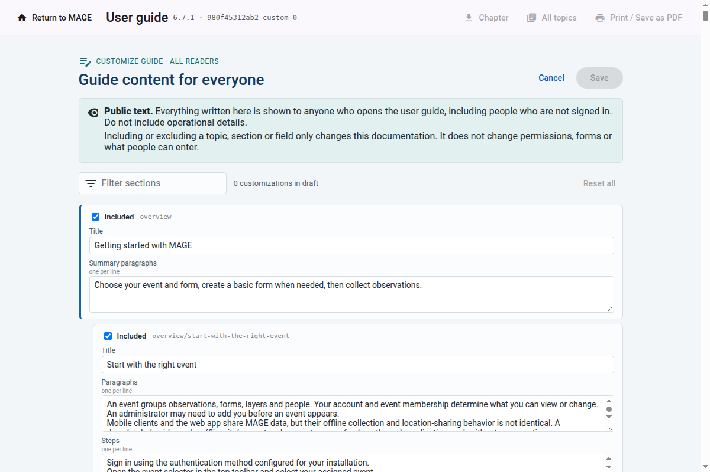

# Customize guide content

This is administrator documentation, separate from the ordinary user guide.
It describes deterministic editing; no AI account or service is needed.

## Find the guide and editor

1. In MAGE open Info / About MAGE.
2. Under Help, choose **Open user guide**. The reader opens in a new tab.
3. Sign in with an `ADMIN_ROLE` or `EVENT_MANAGER_ROLE` account that has
   `UPDATE_SETTINGS`. Choose **Customize guide** for global reader content.
4. For event-specific form guidance, select an event you can read and choose
   **Customize event forms**. This does not grant event access or change forms.

The public guide has no editor for anonymous readers. An unavailable editor can
mean authentication is still being checked, an authentication request failed,
the role/permission is missing, or no authorized event is selected.

## Choose what readers see

Use inclusion checkboxes to hide or include topics, sections and individual
event-form fields. Hidden content is excluded from reader search and exports
as well as the on-screen guide. Newly generated items default to included.
This is documentation visibility only, not a change to application permissions,
field requiredness, form definitions or observation validation.

## Edit text

Edit titles, paragraph text and numbered steps in the draft. The editor stores
overrides separately, not a rewritten copy of the generated source.

- **Save** publishes the draft after validation.
- **Cancel** discards unsaved edits.
- Per-item reset restores automatic text while retaining visibility.
- Reset-all asks for confirmation and still needs Save.
- If another administrator saved first, reload and reconcile the conflicting
  draft rather than repeatedly submitting an old revision.

Source regeneration preserves saved edits. A changed workflow can still make
manual instructions stale; review them deliberately. Stable section/field IDs
keep overrides attached when generated labels change.

## Add and position workflow screenshots

1. Capture a training workflow with fictional users, events and observations.
   Do not upload operational records, credentials or unredacted private data.
2. Upload a PNG, JPEG or WebP of at most 1 MiB. The service rasterizes it to PNG
   and enforces image dimension limits.
3. Supply useful alternative text and a caption.
4. Choose placement before the text, after a paragraph, or after a numbered
   step using the placement controls. Reorder or remove draft pictures as needed.
5. Save, open the reader and verify the picture's position. Check a downloaded
   edition too.

Uploaded pictures are manual overrides, not automatically regenerated captures.
Updating application code cannot determine how to replace your uploaded picture.
Re-capture it when its workflow changes. Cancelling a draft does not publish
an uploaded picture; unreferenced files are not served as published guide images.

## Scope, privacy and offline copies

Global content is publicly readable. Event-form content and event image reads
require access to the selected event. Do not use the global scope for private
event instructions. Never embed passwords or credentials in either scope.

Chapter and full-guide HTML downloads embed their pictures and saved edits.
Use browser Print / Save as PDF for a PDF copy. Offline files are fixed editions:
download again after updates, and protect files containing private event guidance.
Downloading help does not enable offline imagery, feed access or web uploads.

Server operators must back up both MongoDB settings and the MAGE resource
directory containing uploaded guide images. Development regeneration does not
replace either backup.
